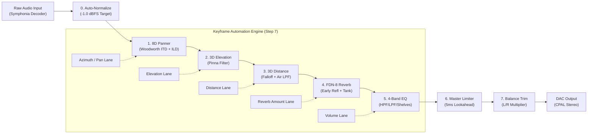

# 🌌 Orbiter

<p align="center">
  
</p>

<p align="center">
  <strong>High-Precision 8D & 3D Spatial Audio Digital Audio Workstation</strong><br />
  <em>Real-time binaural spatialization, physical FDN reverberation, Bézier automation, and neural stem separation.</em>
</p>

<p align="center">
  <a href="https://github.com/HaiCLOP/Orbiter/actions"></a>
  <a href="https://www.rust-lang.org/"></a>
  <a href="https://tauri.app/"></a>
  <a href="https://react.dev/"></a>
  <a href="https://threejs.org/"></a>
  <a href="https://onnxruntime.ai/"></a>
  <a href="LICENSE"></a>
</p>

---

## 🎧 What is Orbiter?

**Orbiter** is an open-source, studio-grade desktop Digital Audio Workstation (DAW) engineered specifically for **real-time 8D and 3D binaural spatial audio composition, mastering, and neural stem decomposition**.

Unlike generic stereo pan plugins, Orbiter models genuine human psychoacoustics:
- **Interaural Time Differences (ITD)** based on the spherical Woodworth head delay model ($\pm 650\,\mu\text{s}$).
- **Interaural Level Differences (ILD)** via frequency-dependent acoustic head-shadow attenuation.
- **Pinna Elevation Filtering** approximating vertical spectral shaping ($\pm 4.0\text{ dB}$ at $8\text{ kHz}$).
- **Atmospheric Air Absorption & Distance Falloff** with dynamic single-pole lowpass damping.
- **Physical Feedback Delay Network (FDN-8)** with an orthogonal Hadamard matrix and distance auto-tie.
- **Neural Source Separation (Demucs v4)** splitting any audio track into Vocals, Drums, Bass, and Other.

Engineered with a **zero-allocation real-time DSP core** in **Rust** (CPAL / Symphonia / Hound / mp3lame) and an **Apple Liquid Glass** UI in **Tauri 2**, **React 19**, **Three.js**, and **Tailwind CSS v4**.

---

## 🚀 Key Features

### 🌐 1. True 3D Spatial Hologram & Hardware Knobs (Step 8)
- **Interactive Three.js 3D Soundstage**: Real 3D scene with camera presets (**3D**, **Top**, **Front**, **Side**), orbit grid rings, and central head model.
- **Spherical Raycast Dragging**: Drag the sound source dot freely across 3D space with continuous azimuth, elevation, and distance mapping.
- **Blender 3D Hardware Knobs**: Detailed 3D hardware dials modeled in Blender with brushed metal textures and responsive rotation for **Azimuth/Pan** and **Master L/R Balance**.

### 🤖 2. Neural Stem Separation (Meta HT-Demucs v4) (Step 11)
- **On-Device Source Separation**: Decomposes any song into 4 isolated stems: **Vocals**, **Drums**, **Bass**, and **Other**.
- **Click-Free Overlap-Add (OLA)**: $25\%$ chunk overlap with linear crossfade mathematically verified click-free ($<10^{-5}$ error).
- **Interactive Mini-Waveforms & Audition**: Instant 500-bin visual waveforms with built-in preview player.
- **1-Click "Send to 8D" Studio Handoff**: Instantly load any isolated stem into the 3D spatial editor for dedicated spatialization.

### 📈 3. Multi-Lane Bézier Automation & Graph Editor (Step 7)
- **Per-Sample Automated DSP**: Real-time evaluation of Azimuth, Elevation, Distance, Reverb Amount, and Volume at audio clock rate.
- **$O(1)$ 256-Entry Newton-Raphson Bézier LUTs**: Monotonic cubic interpolation evaluated in the native audio callback with zero heap allocations.
- **Visual Graph Editor**: High-DPI canvas with draggable keyframe diamonds, Bézier tangent handles, magnetic grid snapping, and 5 built-in orbit presets (*Circle*, *Ellipse*, *Figure-8*, *Spiral In/Out*, *Vertical Pendulum*).

### 🏛️ 4. Physical FDN-8 Environmental Reverb Tank (Step 5)
- **8 Mutually Prime Delay Lines**: Mixed using an $8 \times 8$ orthogonal Hadamard feedback matrix for high echo density without metallic ringing.
- **Per-Line Damping**: Simulates wall absorption materials with adjustable decay times from $0.2\text{s}$ to $12.0\text{s}$.
- **Distance Auto-Tie**: Automatically scales wet reflections based on virtual 3D distance from the listener.

### 🎚️ 5. 4-Band Parametric EQ & Dynamics Rack (Steps 3 & 6)
- **Cascasded Robert Bristow-Johnson Biquads**: Low-Cut HPF (20–500 Hz), High-Cut LPF (2–20 kHz), Bass Shelf ($\pm 12\text{ dB}$ at 100 Hz), and Treble Shelf ($\pm 12\text{ dB}$ at 10 kHz).
- **128-Sample Dual-State Crossfading**: Glitch-free, click-free parameter sweeps.
- **Master Peak Limiter**: 5.0ms lookahead ring buffer with instantaneous attack, $150\text{ ms}$ exponential release, and $C^1$ smooth soft-clipper at 0.0 dBFS.

### 💾 6. Project Persistence (`.orb8d`) & Offline Export (Steps 9 & 10)
- **Session File Format (`.orb8d`)**: Portable JSON project schema preserving audio references, all DSP states, keyframe curves, and UI workspace layouts with schema versioning.
- **Non-Destructive Asset Relinking**: Built-in asset relink dialog if source audio files are moved.
- **Bit-Exact Offline Rendering**: Uses the unified `SpatialDspChain` ensuring zero divergence between live audio playback and rendered export.
- **Multi-Format Export**: 16/24-bit PCM WAV (via `hound`) and 128–320 kbps MP3 (via `mp3lame-encoder`).

---

## 📐 Real-Time DSP Signal Pipeline



---

## 🛡️ Privacy & Zero-Telemetry Guarantee

Orbiter is committed to transparency and user privacy:
- **Zero Analytics**: No telemetry, Google Analytics, Sentry, or tracking beacons.
- **100% On-Device Processing**: Audio decoding, DSP modulation, timeline evaluation, rendering, and Demucs stem inference run entirely on your local CPU/GPU hardware.
- **Network Boundaries**: Orbiter makes zero network requests. The only network call in the entire application occurs when the user explicitly clicks "Download Model" in the Stems tab to fetch the 166 MB Demucs weights from Hugging Face with SHA-256 verification.

See [PRIVACY.md](PRIVACY.md) for full details.

---

## 💻 Platform Support Matrix

| Platform | Architecture | Audio Backend | Hardware Acceleration | Status |
|---|---|---|---|:---:|
| **Windows 10 / 11** | x86_64 | WASAPI / DirectSound | DirectML / DirectX 12 / AVX2 | ✅ Supported |
| **macOS 12+** | Apple Silicon (M-series) & Intel | CoreAudio | CoreML / Metal / Accelerate | ✅ Supported |
| **Linux (Ubuntu/Debian/Arch)** | x86_64 | ALSA / PipeWire | Multi-Threaded AVX2 / OpenMP | ✅ Supported |

---

## 📦 Getting Started

### Prerequisites

1. **Rust Toolchain**: Stable 1.80+ (`rustup update`)
2. **Node.js**: v20 or later (`node -v`) and `npm`
3. **Platform Dependencies**:
   - **Windows**: Visual Studio C++ Build Tools with Windows 10/11 SDK.
   - **macOS**: Xcode Command Line Tools (`xcode-select --install`).
   - **Linux**: WebKit2GTK and ALSA development libraries:
     ```bash
     sudo apt-get update && sudo apt-get install -y \
       libwebkit2gtk-4.1-dev \
       libasound2-dev \
       libssl-dev \
       build-essential \
       curl wget file
     ```

### Installation & Development

```bash
# 1. Clone repository
git clone https://github.com/HaiCLOP/Orbiter.git
cd Orbiter

# 2. Install frontend dependencies
npm install

# 3. Launch desktop development mode (with Vite HMR)
npm run tauri dev
```

### Production Release Build

To build native release installers (`.msi` / `.exe` on Windows, `.dmg` on macOS, `.AppImage` on Linux):

```bash
# Build optimized desktop production release
npm run build
npm run tauri build
```

---

## 🧪 Automated Testing Suite

Orbiter includes **38 native automated unit tests** verifying filter stability, brickwall limiter overshoot clamping, FDN matrix orthogonality, Bézier LUT monotonic continuity, Demucs overlap-add click-free reconstruction, and bit-exact live/offline parity:

```bash
cd src-tauri
cargo test --all
```

All 38 tests pass with 0 failures:
- `test_live_and_offline_dsp_parity_with_automation`: Bit-exact identity between live audio playback and offline rendering under active timeline automation.
- `test_demucs_overlap_add_reconstruction_click_free`: Verifies $25\%$ overlap-add linear crossfade has $<10^{-5}$ seam error and zero audible clicks.
- `test_brickwall_limiter_clamps_overshoots`: Guarantees zero sample overshoots above ceiling.
- `test_fdn_matrix_orthogonality`: Verifies energy conservation in the $8 \times 8$ Hadamard matrix.

---

## 🤝 Contributing

We welcome community contributions! Please read our [CONTRIBUTING.md](CONTRIBUTING.md) guide before submitting PRs. Orbiter follows a **Plan-First Engineering Discipline**: every feature proposal must be vetted for real-time audio safety and mathematical stability before code is written.

---

## 📄 License

Distributed under the **MIT License**. See [LICENSE](LICENSE) for details.
