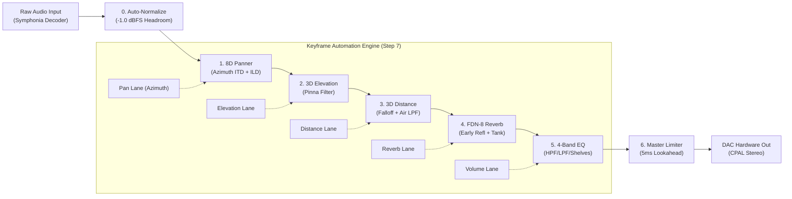

# 🌌 Orbiter

<p align="center">
  
</p>

<p align="center">
  <strong>High-Performance 8D & 3D Spatial Audio Digital Audio Workstation</strong>
</p>

<p align="center">
  <a href="https://github.com/HaiCLOP/Orbiter/actions"></a>
  <a href="https://www.rust-lang.org/"></a>
  <a href="https://tauri.app/"></a>
  <a href="https://react.dev/"></a>
  <a href="https://www.typescriptlang.org/"></a>
  <a href="LICENSE"></a>
</p>

---

## 🎧 What is Orbiter?

**Orbiter** is a professional desktop Digital Audio Workstation (DAW) engineered specifically for **real-time 8D and 3D binaural spatial audio composition**. 

Unlike standard stereo pan tools, Orbiter simulates true human psychoacoustics — combining interaural time differences (ITD), interaural level differences (ILD), pinna spectral cues, atmospheric air absorption, early reflections, and late reverberation into an intuitive interactive 3D soundstage.

Built from the ground up with a custom real-time DSP core in **Rust** (CPAL / Symphonia) and a reactive UI in **Tauri 2**, **React 19**, and **Tailwind CSS**, Orbiter delivers uncompromising audio fidelity with zero-allocation real-time safety.

---

## 🚀 Key Features

- **8D Binaural Orbital Panner**: Smooth continuous spherical trajectory with dynamic Woodworth interaural time delays (ITD) and head-shadow interaural level differences (ILD).
- **3D Elevation & Distance Cues**: Vertical pinna spectral shaping (brightening for above, dulling for below) and distance falloff with atmospheric high-frequency air absorption.
- **FDN-8 Environmental Reverb Tank**: 8-delay-line Feedback Delay Network using an orthogonal Hadamard mixing matrix, per-line absorption damping, and natural distance auto-tying.
- **4-Band Parametric EQ**: Studio-grade cascaded biquad filters (Low-Cut HPF, High-Cut LPF, Bass Shelf at 100 Hz, Treble Shelf at 10 kHz, and master volume) with dual-state crossfading for click-free parameter sweeps.
- **Master Dynamics Rack**: 5.0ms pre-allocated lookahead brickwall peak limiter, $C^1$ asymptotic soft-clipper safety ceiling, and input loudness auto-normalization (-1.0 dBFS target).
- **Multi-Lane Keyframe & Bézier Curve Automation**: Full timeline engine with $O(1)$ 256-entry Newton-Raphson Bézier LUTs driving Azimuth/Pan, Distance, Elevation, Reverb, and Volume live in the audio callback.
- **Interactive Graph Editor**: High-DPI canvas with draggable keyframe diamonds, Bézier tangent handles, magnetic grid snapping, playhead scrub line, and 5 built-in orbit presets.
- **Zero-Allocation Audio Thread**: Real-time CPAL callback performs zero heap allocations and zero lock acquisitions (`Ordering::Acquire` / `Release` atomic coefficient handoff).
- **Latency-Compensated Telemetry**: Visual 3D radar dot, multi-lane graph playhead, and multi-resolution waveform scrubber are clock-compensated for lookahead delay, matching sound arrival at the listener's ears.
- **Tabbed Workspace Architecture**: Dedicated modular views for **Edit**, **Graph**, **Spatial**, **Effects**, and **Render** with contextual property inspector controls.

---

## 📐 DSP Signal Processing Architecture

Every sample passes through an optimized 7-stage real-time DSP pipeline:



### Stage Details

| Order | DSP Stage | Acoustic Function & Mathematics | Live Controls |
| :---: | :--- | :--- | :--- |
| **0** | **Input Normalize** | Targets $-1.0\text{ dBFS}$ raw track peak loudness. Sets consistent input headroom; downstream boosts are caught by the limiter. | Toggle (On / Off) |
| **1** | **8D Binaural Panner** | Spherical head model: $\text{ITD}(\theta) = \frac{r}{c}(\theta + \sin\theta)$ (up to $\pm 650\,\mu\text{s}$) + frequency-dependent ILD head shadow. Automated by Pan lane ($-\pi$ to $+\pi$). | Speed (0.01–5.0 Hz), Intensity (0–100%), Azimuth Keyframes |
| **2** | **3D Elevation** | Approximates vertical pinna cues using a dual-state 128-sample crossfaded peaking biquad ($\pm 4.0\text{ dB}$ at $8\text{ kHz}$). | Elevation (-1.0 Below to +1.0 Above) |
| **3** | **3D Distance** | Inverse-square distance attenuation combined with dynamic 1-pole high-cut filter modeling atmospheric air absorption. | Distance (0.0 Near to 1.0 Far) |
| **4** | **FDN-8 Reverb Tank** | Decorrelated stereo early reflections + 8 mutually prime delay lines mixed with an $8 \times 8$ Hadamard matrix. Distance auto-tie scales wet mix. | Room Size (0–100%), Decay RT60 (0.2–12s), Amount |
| **5** | **4-Band Parametric EQ** | Cascaded Robert Bristow-Johnson biquad filters: Low Cut (20–500 Hz), High Cut (2–20 kHz), Bass Shelf ($\pm 12\text{ dB}$), Treble Shelf ($\pm 12\text{ dB}$). | HPF Hz, LPF kHz, Bass dB, Treble dB, Master Vol |
| **6** | **Master Dynamics** | 5.0ms lookahead ring buffer, instantaneous transient attack, 1-pole exponential release ($150\text{ ms}$ default), and $C^1$ smooth soft-clipper. | Limiter Enable, Ceiling dBFS, Release ms |

---

## 🛠 Tech Stack

- **Audio DSP Core**: Rust (`cpal`, `symphonia`, `std::sync::atomic`)
- **Desktop Bridge**: Tauri v2
- **UI Framework**: React 19, TypeScript
- **Styling**: Tailwind CSS
- **State Management**: Zustand
- **Icons & UI Primitives**: Lucide React
- **Build Tooling**: Vite 8, Cargo

---

## 📦 Getting Started

### Prerequisites

1. **Rust**: Stable 2021 edition (`rustup update`)
2. **Node.js**: v18+ and `npm`
3. **OS Audio Drivers**: DirectSound / WASAPI (Windows), CoreAudio (macOS), or ALSA / PipeWire (Linux)

### Installation & Development

```bash
# Clone the repository
git clone https://github.com/HaiCLOP/Orbiter.git
cd Orbiter

# Install frontend dependencies
npm install

# Run in desktop development mode (with Hot Module Replacement)
npm run tauri dev
```

### Production Release Build

```bash
# Build optimized desktop production release
npm run build
cd src-tauri
cargo build --release
```

The compiled native executable will be located at:
- **Windows**: `src-tauri/target/release/orbiter.exe`
- **macOS**: `src-tauri/target/release/bundle/macos/orbiter`
- **Linux**: `src-tauri/target/release/orbiter`

---

## 🧪 Automated Testing

Orbiter includes an extensive automated test suite covering filter stability, brickwall limiter overshoot clamping, matrix orthogonality, Bézier LUT monotonic continuity, and click-free parameter sweeps:

```bash
cd src-tauri
cargo test
```

All 33 native audio DSP unit tests verify:
- Invariant bounds under extreme parameter modulation
- Bit-accurate unity bypass when stages are centered or disabled
- Monotonic exponential release and energy dissipation in reverberation
- Newton-Raphson Bézier LUT boundary convergence and binary search resolution
- Zero dynamic memory allocations during processing

---

## 🗺 Roadmap & Milestones

- [x] **Step 0**: Tauri 2 + Rust + React 19 workspace scaffolding
- [x] **Step 1**: Symphonia multi-format audio decoding & dual-channel peak envelope extraction
- [x] **Step 2**: Real-time CPAL output stream & 8D binaural rotating panner (ITD/ILD)
- [x] **Step 3**: 4-Band cascaded parametric EQ with click-free dual-state biquad crossfading
- [x] **Step 4**: 3D distance falloff, atmospheric air absorption, and elevation pinna cues
- [x] **Step 5**: FDN-8 environmental reverb tank, distance auto-tie, and 5-tab workspace UI
- [x] **Step 6**: Master Dynamics Rack (5ms lookahead brickwall limiter + input normalize)
- [x] **Step 7**: Multi-lane keyframe curve automation editor (Graph tab & 5 Orbit Presets)
- [ ] **Step 8**: Offline full-speed non-realtime export to WAV / FLAC (Render tab)
- [ ] **Step 9**: Spatial presets library & master soundstage polish

---

## 📄 License

Distributed under the MIT License. See `LICENSE` for details.
